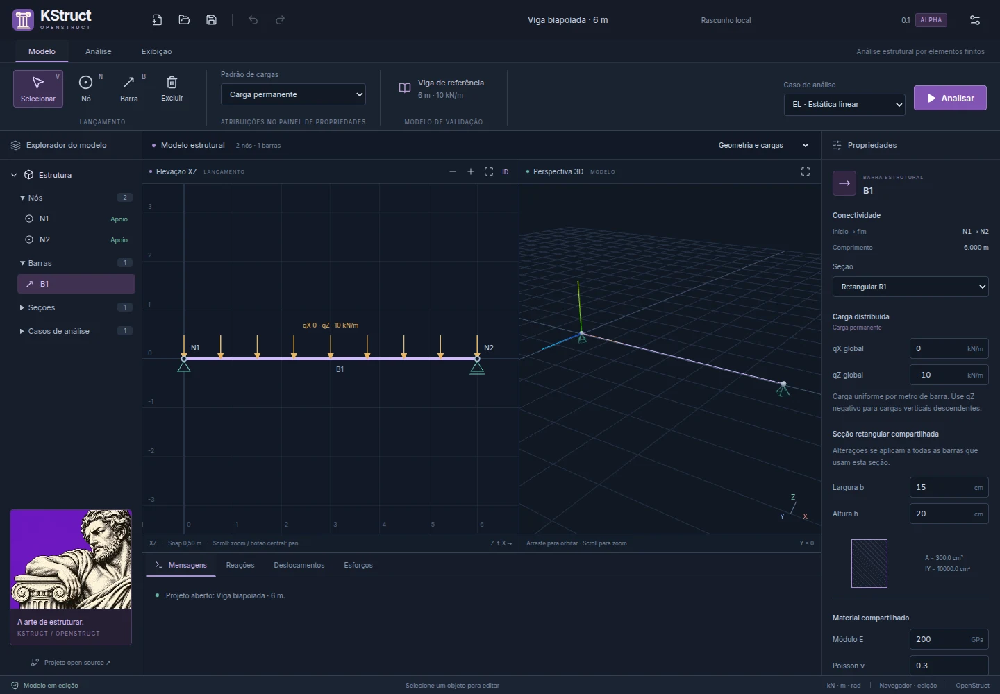
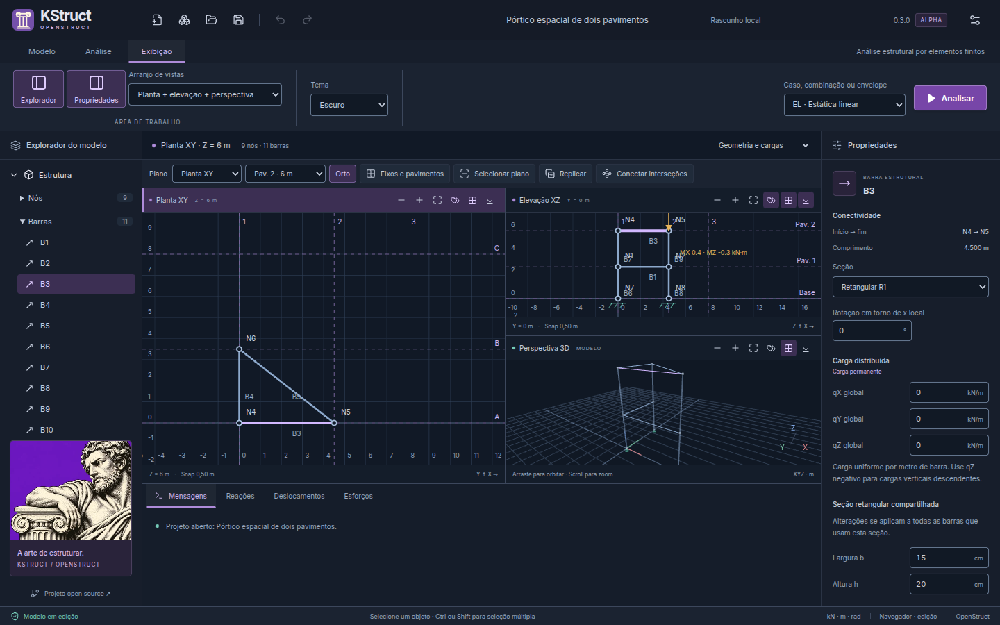

# KStruct

**Análise estrutural open source, parte do ecossistema OpenStruct.**

KStruct faz referência à matriz de rigidez **[K]**. A direção do produto é um ambiente completo de lançamento, análise e interpretação de estruturas, com a fluidez de trabalho de ferramentas como SAP2000 e uma identidade própria.



## Recursos no código atual

O editor trabalha com projetos **planos XZ** ou **espaciais XYZ** e usa a mesma seleção na vista de lançamento, na perspectiva 3D e no explorador.

- Lançar barras e nós em planta XY ou elevações XZ/YZ, com eixos, pavimentos, modo ortogonal e snap em referências ou passos de 0,50 m.
- Mover nós e barras, espelhar módulos e replicar por translação ou rotação com prévia. Escolher os apoios e padrões de carga das cópias e conectar interseções em 3D.
- Editar coordenadas, apoios em referenciais globais ou inclinados, seções retangulares, circulares, tubulares e I, orientação da seção e cargas globais.
- Escolher unidades de comprimento, seção, deslocamento, força, momento, carga distribuída e módulo de elasticidade em **Exibição → Unidades**. A escolha fica nas preferências locais.
- Aplicar forças e momentos nodais e cargas uniformes em barras. Peso próprio é manual nesta etapa.
- Lançar uma laje retangular isolada em planta XY, editar apoios, pressão e malha e consultar mapas de flecha e momentos locais.
- Salvar e reabrir `.kstruct.json` no esquema v11, com migração dos projetos v1 a v10 na abertura. Desfazer e refazer até 50 edições e recuperar o último rascunho local.
- Executar o OOFEM 3.0 integrado nos pacotes Windows e Linux, com diagnóstico, cancelamento e histórico local.
- Resolver a estática linear com `Beam2d` ou `Beam3d`. Consultar os seis componentes de reações, deslocamentos e esforços no modelo espacial, além de deformada, diagramas, CSV e saída do OOFEM.
- Invalidar resultados após alterações. Verificar conectividade, apoios de cada componente e equilíbrio global antes de apresentar resultados.

No navegador, use o editor e a exportação de entrada. O botão **Analisar** executa o solver nativo na aplicação desktop.

## Instalar e executar

Encontre o KStruct no [Struct Launcher](https://openstruct.com.br/launcher). Consulte a [distribuição desktop](docs/DISTRIBUTION.md) para baixar os pacotes avulsos e conferir a instalação.

Para desenvolvimento, use Node.js 22.12 ou superior.

```sh
npm ci
npm run dev
```

Abra `http://127.0.0.1:1420`. Para o aplicativo desktop, instale Rust 1.89 ou superior e os [pré-requisitos do Tauri 2](https://v2.tauri.app/start/prerequisites/).

```sh
npm run desktop:dev
```

Para compilar a aplicação e os pacotes da plataforma atual:

```sh
npm run desktop:build
```

A compilação dos pacotes prepara o OOFEM a partir do commit fixado da versão 3.0. No modo de desenvolvimento, configure um executável com `OOFEM_BIN` ou pelo caminho em **Configurar OOFEM**. Consulte [seleção e diagnóstico do motor](docs/OOFEM.md).

## Primeiro uso

Para explorar os envelopes de esforços, baixe o [projeto de exemplo do pórtico em L](examples/portico-em-l-envelopes.kstruct.json) e siga o [roteiro de análise e conferência](examples/README.md).

1. Abra **Viga de referência**. Ela contém 6 m de vão, seção 15 × 20 cm, E = 200 GPa e carga de −10 kN/m em Z.
2. Selecione a barra ou um nó em qualquer vista ou no explorador. As propriedades aparecem à direita.
3. No desktop instalado, clique **Analisar**. Reações esperadas de 30 kN por apoio, momento de meio de vão 45 kN·m e flecha −8,4375 mm.
4. Altere a carga e analise novamente. A edição remove os resultados anteriores.
5. Para começar do zero, use **Novo projeto** para XZ ou **Novo pórtico espacial** para XYZ. Ative **Barra** (`B`) e marque duas extremidades. Defina apoios e cargas antes de analisar.

No modelo espacial, defina os eixos e as cotas em **Eixos e pavimentos**. Escolha o pavimento para lançar vigas em planta e alterne para uma elevação para lançar pilares. **Orto** alinha a segunda extremidade no plano. Segure `Shift` para inverter o modo durante o clique. Use `Ctrl` ou `Shift` para montar uma seleção e **Replicar** para copiar a geometria até outro pavimento. Use **Conexões da malha** para ligar um nó interno, um montante ou duas barras que se cruzam em XYZ. Em **Editar barras**, a opção **Dividir** cria peças físicas independentes.

Para lançar um banzo contínuo, crie a barra entre os nós extremos e lance os montantes nas posições desejadas. Em **Modelo → Conexões da malha**, escolha o banzo, o nó de cada encontro e **Conectar**. Ative **Malha de análise** na vista para inspecionar os pontos regulares e os anéis das conexões. Em **Esforços**, o mesmo ID de barra reúne todo o diagrama. **Lado i** e **Lado j** identificam os limites da seção quando a carga ou o montante transfere esforço.

Para transformar a seleção, abra **Replicar** no modelo espacial ou **Transformar** no modelo plano. Escolha a operação. Em **Mover por vetor**, expanda **Barras incidentes** para conferir os comprimentos antes e depois do movimento. Para espelhar, indique um ponto e a reta em XZ ou o plano em XYZ. Na rotação, defina o centro, o eixo, o passo angular e o número de cópias. Por exemplo, um passo de +90° em torno de Z, com centro na origem, leva (2, 0, 0) a (0, 2, 0).

As cópias preservam seção e orientação. Por padrão, os novos nós ficam livres e sem carga. Marque **Copiar apoios** e os padrões que deseja levar. Ao reutilizar um nó com dados conflitantes, escolha entre conservar os dados existentes ou unir vínculos e somar cargas dentro do mesmo padrão. Uma cópia girada ou espelhada conserva a direção física do vínculo. Se essa direção for oblíqua, o novo nó recebe um referencial local. Confirme para aplicar toda a operação em uma edição, que pode ser desfeita de uma só vez.

Em **Modelo → Duplicidades**, informe a tolerância na unidade de comprimento selecionada e selecione um par para destacá-lo nas vistas. Por exemplo, 0,001 m corresponde a 1 mm. Escolha o nó ou a barra que conservará o ID. A lista de barras considera as uniões de nós já marcadas e reconhece extremidades invertidas. Confira os apoios, as incidências, as seções, as cargas por padrão e os grupos na prévia. **Aplicar correções** registra uma edição no histórico. **Cancelar** descarta as escolhas. Ao reabrir o diagnóstico, os pares mantidos independentes voltam a aparecer.

Em **Modelo → Editar barras**, selecione uma barra para **Dividir**, **Aparar** ou **Prolongar**. Na divisão, a distância parte do nó inicial i. Para ajustar uma ponta, indique i ou j e escolha um nó, uma coordenada global ou outra barra como referência. Quando o corte atinge o interior de outra barra, a prévia inclui seus novos trechos e ambos usam o mesmo nó. Para **Unir**, selecione as barras com `Ctrl` e abra o comando. Confira as extensões, os padrões de carga e as resultantes antes de aplicar. Uma operação corresponde a um passo de desfazer.

Em **Barra** (`B`), escolha o **Traçado**. **Dois pontos** lança uma barra por par de cliques. **Em cadeia** aproveita a última extremidade para o próximo trecho. **Vão entre eixos** destaca o intervalo entre duas guias consecutivas e o lança com um clique. Aponte para o interior do vão para indicar a direção. Escolha a seção ativa e, em XYZ, a rotação em graus. `Esc` encerra o lançamento e **Desfazer** remove um trecho por vez.

Em **Modelo** → **Tabela de nós**, edite as coordenadas de vários nós na unidade de comprimento selecionada (metros por padrão). A tabela mostra X e Z no modelo plano e X, Y e Z no espacial. Use vírgula ou ponto para decimais e corrija as células destacadas antes de clicar em **Aplicar**. **Cancelar** descarta o rascunho. **Desfazer** e **Refazer** atuam sobre o lote inteiro. Após aplicar uma alteração, analise novamente para atualizar os resultados.

Em **Colar planilha (TSV)**, escolha a unidade das coordenadas copiadas e cole os nós e as barras. Confira os IDs e os comprimentos na prévia antes de aplicar. Uma barra pode usar nós criados no mesmo lote.

Nos modos **Nó** e **Barra**, aproxime o cursor do ponto médio de uma barra ou da perpendicular a partir do último ponto. Para posicionar a próxima extremidade por incremento, informe os dois valores Δ na unidade exibida e pressione **Enter**.

Em **Exibição → Unidades**, selecione as unidades para cada grandeza e clique em **Aplicar unidades**. Por exemplo, o vão de 6 m aparece como 600 cm ou 6000 mm, e E = 200 GPa aparece como 200000 MPa. Os campos, eixos, pavimentos, réplicas, modelos paramétricos, vistas e tabelas acompanham a escolha. A troca preserva o modelo, o histórico e os resultados da revisão atual. O arquivo do projeto e a entrada OOFEM continuam em SI. O CSV identifica as unidades selecionadas e conserva o formato existente ao usar as preferências padrão. Rotações das tabelas continuam em mrad; pressão da laje em kN/m² e momentos da laje por metro de largura mantêm unidades explícitas.

Em **Exibição → Arranjo de vistas**, escolha **Planta + elevação + perspectiva** para acompanhar um pórtico espacial nos três painéis. Clique ou dê foco ao painel em que quer trabalhar. A faixa acima do desenho identifica a vista ativa e sua cota. Os controles de plano e eixo atuam nessa vista. Zoom, enquadramento, nomes, grelha e cargas podem ser ajustados em cada painel. Trocar de vista cancela o trecho em andamento e preserva as peças já lançadas. No projeto plano, use a elevação XZ sozinha ou ao lado da perspectiva.



No modo **Selecionar** das vistas 2D, arraste da esquerda para a direita para conter objetos inteiros ou da direita para a esquerda para incluir os que cruzam a janela. `Ctrl` ou `Shift` adiciona o conjunto. `Esc` cancela o arraste. Em **Seleção e grupos**, combine tipo, pavimento, material e seção. Um pavimento inclui barras com as duas extremidades na mesma cota. Escolha **Aplicar critérios**, dê um nome e use **Salvar seleção como grupo** para recuperar as mesmas peças depois de reabrir o arquivo. Os grupos guardam os IDs dos objetos.

Em **Exibição → Tema**, escolha **Claro** ou **Escuro**. A primeira abertura usa o tema escuro. A escolha é guardada nas preferências locais e vale para a interface e as duas vistas, inclusive durante a consulta de resultados.

Em **Exibição → Eixos locais**, mostre a seta x de i para j e a tríade nas vistas. Selecione uma ou mais barras para mostrar os eixos apenas dessa seleção. Em 2D, ⊙ indica um eixo que aponta para quem observa e ⊗ indica o sentido oposto. No diagrama de esforços, a barra selecionada mostra os valores em i (`x/L = 0`) e j (`x/L = 1`).

No inspetor da barra, **Inverter i/j** troca o início e o fim, mantendo o ID, a seção na mesma orientação física e as cargas globais. Confira o novo sentido e a projeção local do padrão de carga ativo. Em XYZ, edite **Rotação em torno de x local** para girar fisicamente a seção. Em XZ, o giro da seção fica fixo em 0°. A inversão e a edição do ângulo entram no histórico e exigem nova análise.

Em **Novo projeto**, escolha **Viga contínua** para informar os vãos em X ou **Pórtico regular** para definir vãos e alturas dos pavimentos. No modelo espacial, informe também os vãos em Y. Confira as quantidades de nós e barras na prévia e clique em **Gerar projeto**. Os nós começam livres e as cargas podem ser lançadas no editor.

### Atribuição em lote

Selecione nós e barras com Ctrl ou recupere um grupo em **Seleção e grupos**. Em **Propriedades → Atribuição em lote**, escolha a seção, os graus a restringir ou liberar e as componentes de carga a somar, substituir ou remover no padrão ativo. A prévia identifica os objetos afetados. Quando há apoios inclinados, abra **Referenciais dos nós selecionados** para conferir a direção de cada vínculo. As cargas nodais e distribuídas usam eixos globais.

Por exemplo, em duas barras com qZ de −2 e −3 kN/m, **Somar** −1 kN/m produz −3 e −4 kN/m. **Aplicar lote** registra toda a operação em uma edição. **Desfazer** recupera a seção, os vínculos e as cargas anteriores de cada objeto.

### Apoios inclinados

Selecione um nó e escolha **Local** em **Propriedades → Apoios e restrições → Referencial do apoio**. Em XZ, informe o ângulo da tangente em graus a partir de +X no sentido de +Z. Confira a prévia e clique em **Aplicar referencial**. Um rolete bloqueia apenas a translação Z local, que corresponde à normal, e deixa livres a translação X local e a rotação Y. Em XYZ, informe a direção de x local e uma direção para y. O editor mostra a base ortonormal de mão direita antes de aplicar. As cargas nodais continuam expressas em XYZ globais.

Analise o caso e abra **Reações**. Quando houver um apoio local com reação, a tabela e o CSV incluem colunas globais e locais, com unidades e o referencial de cada apoio. Em XZ, RX local corresponde à tangente e RZ local à normal. Para reproduzir a viga de 6 m com rolete inclinado, mantenha o nó inicial global e aplique −36,86989765° ao nó final da **Viga de referência**. [Valores esperados](docs/VALIDATION.md#ks-20--apoios-inclinados)

### Materiais do projeto

Em **Modelo → Materiais**, cadastre o módulo E na unidade selecionada (GPa por padrão), o coeficiente de Poisson ν, a massa específica ρ em kg/m³ e a dilatação linear α em 1/K. Ao editar um material compartilhado, confira em **Uso no projeto** os nomes e a quantidade de seções e lajes afetadas. **Salvar material** aplica a alteração a esses usos.

Para testar outro módulo, selecione o material, clique em **Duplicar material**, edite a cópia e salve. Escolha a seção em **Seção ou laje de destino** e clique em **Atribuir material**. Se várias barras usam a mesma seção e apenas uma deve mudar, use **Duplicar seção**, atribua o novo material à seção copiada e escolha essa seção no inspetor da barra. Cada atribuição pode ser desfeita. Para excluir um material em uso, reatribua primeiro as seções e lajes listadas.

### Seções de barras

No explorador do **Modelo**, expanda **Seções** e clique no nome de um perfil. O botão **Catálogo de seções** também abre o catálogo pelo inspetor de uma barra. Em **Nova seção**, escolha a forma e o material, dê um nome e informe as dimensões na unidade de seção selecionada (cm por padrão). O tubo usa diâmetro externo e espessura de parede. O perfil I usa altura total, largura das mesas e espessuras de mesa e alma.

Para aplicar o perfil, selecione a barra e altere **Seção da barra**. Para lançamentos novos, use **Seção ativa**. O inspetor mostra o contorno, os eixos locais, a área e as propriedades Iy, Iz e J na unidade de seção elevada à segunda e à quarta potência, respectivamente. Editar uma seção compartilhada atualiza todas as barras que a referenciam. Analise novamente o modelo para obter os resultados da nova revisão.

### Laje retangular isolada

1. Abra **Novo pórtico espacial**, deixe a **Planta XY** ativa e selecione o pavimento. Ative **Laje** (`L`) e clique em dois cantos opostos do painel.
2. Nas propriedades, informe os lados e a espessura nas unidades selecionadas (m e cm por padrão), o material, as bordas com apoio simples, as subdivisões em X/Y e a **Pressão pZ** em kN/m² para o padrão escolhido. O sinal negativo indica pressão para baixo. Em **Elemento de placa**, o quadrilateral **QDKT** usa apoio simples nas quatro bordas. O triangular **DKT** permite liberar bordas e requer pelo menos duas apoiadas.
3. Salve o projeto. No desktop, selecione o caso estático e clique em **Analisar**. O seletor de visualização oferece os mapas de **Flecha UZ**, **Momento local Mx** e **Momento local My**. O painel de resultados mostra os valores no centro e a soma de reações em Z.
4. Para reproduzir a [placa de referência QDKT](docs/VALIDATION.md#placa-retangular-simplesmente-apoiada), use 4 × 3 m, espessura de 10 cm, E = 30 GPa, ν = 0,20, as quatro bordas apoiadas e pZ = −5 kN/m². Repita com 8 × 6, 16 × 12 e 32 × 24 subdivisões.

O fluxo de laje usa um painel isolado por projeto e resultados por caso estático. As propriedades do painel e da malha são guardadas no arquivo. Edições, desfazer e refazer descartam os resultados da revisão anterior.

### Padrões, casos, combinações e envelopes

Abra **Cargas e casos** para criar padrões como permanentes, sobrecarga ou vento Y e definir casos estáticos com os fatores de cada padrão. Em **Modelo**, selecione o padrão no qual deseja trabalhar e atribua as ações pelos campos de propriedades de cada nó ou barra.

No desktop, escolha um caso estático em **Caso, combinação ou envelope** e clique em **Analisar**. Repita para os demais casos. O seletor alterna entre os resultados da revisão atual.

Para combinar os resultados, abra **Cargas e casos** → **Combinações lineares** e cadastre os casos e seus fatores. Informe ao menos um fator diferente de zero. Depois de aplicar as definições e analisar os casos com fatores diferentes de zero, selecione a combinação em **Caso, combinação ou envelope**. O KStruct exibe a composição, a deformada, os diagramas e as tabelas. Os CSVs identificam a origem das linhas e registram os IDs e fatores dos casos que compõem cada combinação.

Na aba **Esforços** de um caso ou combinação, use **Barra** para filtrar as estações da tabela e do CSV. A opção inicial é **Todas as barras**. Quando dois nomes coincidem ou uma barra se chama “Todas as barras”, o seletor, a tabela e o CSV identificam as barras pelo ID seguido do nome, por exemplo, `[V2] Viga`. O filtro acompanha a troca de resultados do projeto e volta a **Todas as barras** se a barra selecionada for removida.

Em **Cargas e casos** → **Envelopes**, dê um nome ao envelope e marque as combinações que participam. Depois de analisar seus casos, selecione o envelope e o componente de esforço. As curvas indicam o mínimo e o máximo com sinal nas estações da malha. Clique no diagrama ou escolha **Barra** e **Estação x/L** para consultar a combinação governante de cada extremo e todos os esforços que atuam simultaneamente naquela seção. O CSV inclui as estações de todas as barras para o componente em exibição, com IDs e fatores para rastrear cada extremo. Uma edição do projeto ou das definições descarta os resultados em memória.

Use `V` para selecionar, `N` para criar nó, `B` para criar barra, `L` para lançar laje, `Esc` para cancelar lançamento, `Delete` para excluir seleção, `Ctrl+Z` para desfazer, `Ctrl+Shift+Z` para refazer e `Ctrl+S` para salvar. Na elevação, scroll aproxima e afasta, botão central arrasta. A vista 3D orbita ao arrastar.

## Verificação

```sh
npm run check
npm run build
npx playwright install chromium
npm run test:e2e
```

Os benchmarks numéricos exigem `OOFEM_BIN`. Sem ele, aparecem explicitamente como **skipped**. A CI executa os benchmarks com o commit da tag 3.0 e verifica os pacotes instalados em Windows e Linux.

```sh
OOFEM_BIN=/caminho/absoluto/oofem npm test
OOFEM_BIN=/caminho/absoluto/oofem npm run test:e2e -- spatial.spec.ts load-cases.spec.ts slab.spec.ts
cargo test --manifest-path crates/solver-runner/Cargo.toml
```

Veja [validação e limites](docs/VALIDATION.md), [arquitetura](docs/ARCHITECTURE.md) e [sequência de desenvolvimento](docs/ROADMAP.md).

## Licenças

Código original KStruct sob MIT. Os pacotes desktop incluem o OOFEM como executável independente, com sua licença LGPL-2.1-or-later, fontes correspondentes e instruções de compilação. [Avisos de terceiros](THIRD_PARTY_NOTICES.md).

Desenvolvimento inicial. Cada ampliação da capacidade de análise deve ser acompanhada por casos de referência e verificações numéricas específicas.
